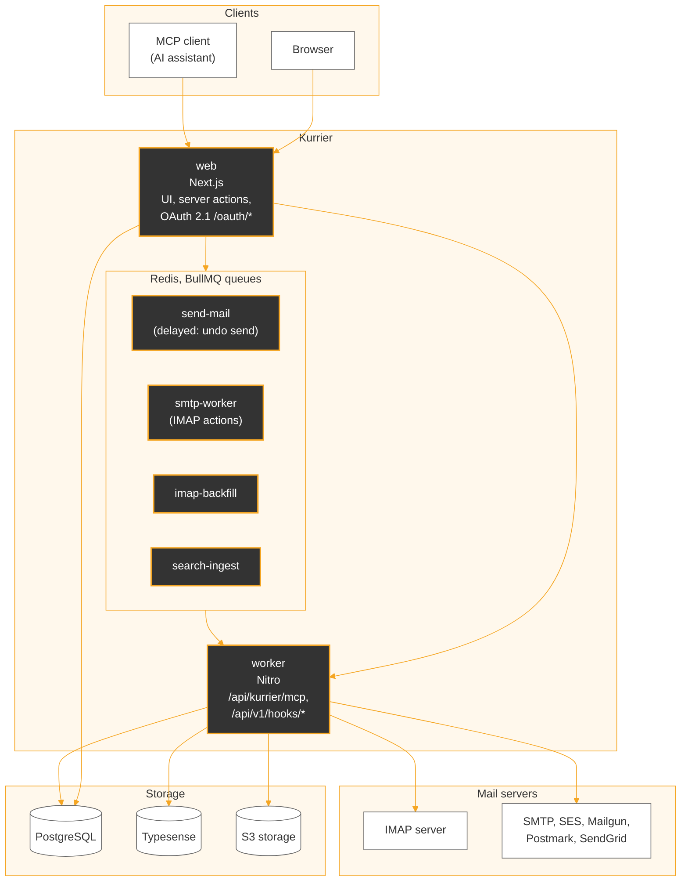

# Kurrier, community fork maintained by SS2i Services

This repository is a fork of [Kurrier](https://github.com/kurrier-org/kurrier), maintained by SS2i Services. It is based on Kurrier **v3.0.11** and adds the changes listed below, written while using Kurrier every day as a team webmail on top of an existing IMAP/SMTP server. Porting these changes to Kurrier v4 is in progress and tracked separately; until then, this fork does not include what upstream released after v3.0.11.

Everything upstream provides is still here. Kurrier is developed by its authors at [kurrier-org/kurrier](https://github.com/kurrier-org/kurrier); their README follows this section, unchanged. Licence: AGPL-3.0-or-later, as upstream.

## What this fork adds

### Synchronisation and IMAP

- Backfill of older mail runs in its own queue (`imap-backfill`), so moves, deletions and flag changes no longer wait behind it.
- Backfill is idempotent: only UIDs missing from the database are fetched, folders are processed in turns up to the identity's daily quota, Trash and Spam are skipped, finished folders are marked as done, and a message keeps the date of its header rather than the time of its import.
- Gmail: "All Mail" is backfilled last and deduplicated by Message-ID, so archived Gmail messages are available.
- A message the database rejects (for example one containing NUL bytes) is logged and skipped instead of blocking the account.
- Threads split by out-of-order arrival (a reply imported before its parent) are merged when the parent arrives, by a `merge_threads` SQL function backed by a GIN index on `messages.references`.
- Moves to another folder: destination UIDs are resolved by Message-ID instead of relying on the order of `COPYUID` (which some servers permute); the destination folder's sync cursor is updated once the move is done; messages the server did not move are put back in their source folder; when the IMAP server is unreachable, nothing moves.
- System folders get canonical slugs, and an Archive folder is created at discovery when missing.

### Reading

- Remote images stay blocked until requested, with a visible state; "always load for this sender" is stored per user.
- Plain-text messages keep their line breaks and alignment; forwarded Gmail messages are shown in full; tables in HTML mail no longer break words in the middle; Outlook emoji images are displayed.
- Inline images already shown in the body are not repeated in the attachment list; the download arrow downloads instead of opening.
- One-click actions in the message header (reply all, archive, mark as unread, delete, block sender).

### Writing

- HTML signature per identity.
- Optional RFC-style replies (reply below the quote, signature last after the `-- ` separator, RFC 3676 section 4.3), per user; the quoted text can be edited before sending; the attribution date uses `MAIL_TIMEZONE`.
- `data:` images in the HTML body are sent as inline (`cid:`) attachments.
- Drafts are saved automatically to the IMAP Drafts folder, with a copy in the browser's localStorage until the server has it.
- Recipients can be dragged between To, Cc and Bcc; Enter takes the first suggestion.
- Recipient suggestions are ranked by actual use: frequency with a 30-day decay, plus addresses usually written to together, computed from sent mail. Contacts are created only for people you wrote to.
- Undo send: a message leaves after a per-user delay (30 s by default; 0, 5, 10, 20, 30 or 60 s), through a delayed job.
- Cc and Bcc recipients are passed to the SMTP transport.

### Organising

- Delete, archive and move act immediately on screen, with Undo for 6 seconds.
- Select all across pages (up to 5,000 conversations, with a banner that says so), range selection with Shift+click.
- Subscriptions: `List-Unsubscribe` support (one-click POST per RFC 8058, or mailto), and a settings page listing subscriptions.
- Sender blocking by address or domain, with an option to move existing mail from that sender to Trash.
- Spam folder: likely legitimate messages are preselected, with a "Not spam" action.
- Auto-responder set from the settings and stored on the mail server through JMAP `VacationResponse` (RFC 8621), so it works whatever client is used; it requires a JMAP-capable server (`JMAP_URL`).
- Per-user preferences: subject only or subject and preview in the list, message order in a thread, unread side panel next to the open thread, undo-send delay, interface.
- Search: lighter Typesense index (message bodies are not indexed), search by sender domain.

### Keyboard

- Shortcuts for compose, reply, forward, archive, delete, mark as unread, search, send (Ctrl+Enter), help (`?`), and next/previous conversation in the three-column interface. Each user can change them in the settings. No single-key shortcut fires while typing in an editor.

### Three-column interface

- An optional interface, chosen per user in Settings > General > Interface: folders, list and reading pane side by side, pinned threads at the top of a folder, an "Unread" filter, messages of a thread as collapsible cards. The classic interface remains the default.

### MCP server

- A [Model Context Protocol](https://modelcontextprotocol.io) endpoint at `/api/kurrier/mcp` (Streamable HTTP, stateless JSON-RPC), served by the worker behind the web app's existing `/api/kurrier/*` rewrite, so an AI assistant can read and act on the user's mailbox.
- Built-in OAuth 2.1 authorization server for MCP clients: discovery metadata (RFC 8414, RFC 9728), dynamic client registration (RFC 7591), authorization code with PKCE, refresh tokens, revocation. Tokens and codes are stored hashed. Kurrier API keys are also accepted, with their scopes.
- Tools: `whoami`, `list_identities`, `list_folders`, `list_threads`, `search`, `get_thread`, `get_attachment`, `send_email`, `reply`, `forward`, `list_drafts`, `get_draft`, `create_draft`, `update_draft`, `delete_draft`, `send_draft`, `mark_read`, `mark_unread`, `star`, `unstar`, `move_to_folder`, `archive`, `trash`. Each call resolves ownership from the authenticated user down to the identity, folder, thread and message.
- In the web UI, a message or a whole thread can be copied to the clipboard as plain text.

### Security

- Access control on Next.js server actions: every exported action checks the session and ownership before touching data. `node apps/web/scripts/check-server-actions.mjs` fails if an exported action does not.
- Inbound provider webhooks (`/api/v1/hooks/*`) require the provider's proof (SES SNS signature and topic allowlist, Mailgun signing key, Postmark token, SendGrid signature) and are refused when the secret is not configured.
- Outgoing HTTP requests to user-supplied URLs go through an SSRF guard (`packages/common/src/safe-http.ts`).
- Send guards in the worker (sender identity and upload prefixes must belong to the sending user); calendar invitation replies and attachments are checked against the user's workspace.
- Fixes backported from upstream v4, including the CWE-306 fix on permanent deletion (#560).

### Robustness

- Session check in the proxy, with a redirect to the login page.
- A tab still running an older deployment reloads instead of failing on missing server actions; error pages offer a reload instead of a dead end; an unknown folder or identity in the URL redirects instead of failing.
- Time zone data for the mailbox view is computed once per process.

## Architecture

The web app forwards `/api/kurrier/*` and `/api/v1/*` to the worker. MCP clients authenticate against the web app's OAuth endpoints, then call `/api/kurrier/mcp` with the bearer token. Actions on mail (send, move, delete, flags) are queued in Redis and executed by the worker against the user's IMAP and SMTP servers.

## Running this fork

Installation and configuration are the same as upstream; see the [Kurrier documentation](https://www.kurrier.org). Differences:

- **Images.** `db/docker-compose.yml` pulls upstream's `ghcr.io/kurrier-org/kurrier-web` and `kurrier-worker` images. To run this fork, build the images from this repository (`apps/web/Dockerfile`, `apps/worker/Dockerfile`) and point the compose file at them.
- **Database.** Four migrations are added (`db/init/migrations/community_001` to `community_004`, prefixed so that they never share a name with upstream's own numbered migrations: MCP OAuth tables, recipient statistics, blocked senders, thread merging). The bootstrap service applies them like upstream's, in order.
- **Inbound webhooks.** If you receive mail through provider webhooks, set the matching secret, otherwise the worker answers 403.

Environment variables added by this fork, all optional:

| Variable | Service | Purpose |
|---|---|---|
| `MAIL_TIMEZONE` | web, worker | Time zone of quote attribution dates (default `UTC`). |
| `MCP_PUBLIC_ORIGIN` | web, worker | Public origin of the MCP endpoint and its OAuth metadata (default `WEB_URL`). |
| `JMAP_URL` | web | JMAP base URL for the auto-responder (default `http://<IMAP host>:8080`). |
| `SES_INBOUND_TOPIC_ARNS` | worker | Accepted SNS topic ARNs for SES inbound mail, comma-separated. |
| `MAILGUN_WEBHOOK_SIGNING_KEY` | worker | Mailgun webhook signing key. |
| `POSTMARK_INBOUND_TOKEN` | worker | Shared secret expected on the Postmark inbound webhook URL. |
| `SENDGRID_INBOUND_PUBLIC_KEY` | worker | SendGrid Inbound Parse verification public key. |
| `KURRIER_BACKFILL_SUBSCRIPTIONS` | worker | Set to `1` once to rebuild mailing-list subscriptions from stored messages, then remove. |

Tests added by this fork live in `apps/web/test` and `apps/worker/test`; each file starts with the command that runs it. Tests that need a database read `MCP_TEST_DATABASE_URL` (a disposable PostgreSQL with the migrations applied).

---

*The rest of this file is the upstream Kurrier README.*

# Kurrier
The self-hosted open-source workspace for **email, calendars, contacts and storage**.

> If Kurrier is useful to you, please consider ⭐ starring the repository and sharing it with others who care about open, self-hosted infrastructure. Word of mouth and GitHub stars help the project grow, attract contributors, and accelerate development.

### ☁️ Looking for a hosted version?

Choose the hosted experience that fits your needs:

- **Kurrier Cloud** — For teams with shared inboxes assignments, priorities, team collaboration, and more.    
  https://www.kurrier.io

- **Kurrier Mail** — For individuals or teams wanting hosted workspaces for email, calendars, contacts, and storage using your existing email provider, including Gmail, Google Workspace, and any SMTP-compatible provider
  https://www.kurriermail.com   
  

## ✨ What's New

### 🎉 Kurrier Drive — integrated **WebDAV/S3 storage**
Store and manage files directly within Kurrier using **WebDAV** locally or S3-compatible storage
Support for providers like AWS S3, Backblaze B2, MinIO, and DigitalOcean Spaces is coming soon.
Have a provider you want first? Open an issue and let us know.

### 🎉 Sync your calendars across all your devices
Kurrier now supports Calendars and syncs your calendars through **CalDAV**, compatible with iOS, macOS, Android (DAVx⁵), Thunderbird, and all CalDAV-supporting apps.

#### Dark Mode:

### 🎉 Full **CardDAV support** — sync your contacts across all your devices
Kurrier now supports **complete CardDAV sync**, meaning your address book updates instantly across iOS, macOS, Android (DAVx⁵), Thunderbird, and any CardDAV-compatible app.

---

### 🎉 Kurrier now supports **Labels**
Organize your inbox your way with flexible, multi-color labels.

---

## 🚀 What is Kurrier?

Kurrier is a **self-hosted, unified communication platform** that brings together:

- 📧 Email (IMAP/SMTP/SES/SendGrid/Mailgun/Postmark)
- 📅 Calendars (CalDAV)
- 👤 Contacts (CardDAV)

All wrapped into a clean, fast, modern web UI — entirely powered by **your** providers and hosted on **your** infrastructure.

Kurrier lets you:

- Connect **any email provider**
- Sync calendars across devices
- Sync contacts across devices
- Manage multiple identities and domains
- Use SES/SendGrid/Mailgun as outbound identities
- Keep all data private and under your control

Whether you're running a personal server, a small-business mail setup, or a multi-domain environment, Kurrier gives you a **beautiful unified interface** without losing control of your data.

---

## 💡 Why Kurrier?

Kurrier is designed as a next-generation alternative to traditional webmail and PIM suites:

- **Connect any provider**  
  IMAP, SMTP, SES, SendGrid, Mailgun, Postmark — or your own mail server.

- **Unified web interface**  
  Email, calendars, and contacts — consistent, fast.

- **Self-hosted first**  
  Your data stays on *your* server. No third-party analytics. No vendor lock-in.

- **Open standards**  
  IMAP/SMTP for mail, CalDAV for calendars, CardDAV for contacts.

- **Modern app stack**  
  Next.js • TypeScript • Nitro • PostgreSQL — fast and extensible.

- **Developer-friendly**  
  Clean APIs, delta sync model, extensible providers.

- **Docker-ready**  
  Simple, reliable deployments.

Kurrier aims to combine the simplicity of a webmail client with the flexibility of a complete, modern communication backend — all under your control.

---

## 📘 Next Steps

Ready to try it out?

👉 **[Read the documentation](https://www.kurrier.org)**  
Guides include installation, provider setup, instructions, and more.

---

## 🖥 Screenshots

### 📨 Webmail View
Minimal, fast, keyboard-first email.

---

### 🌙 Dark Mode
A beautiful, fully themed dark interface.

---

### 🔌 Providers View
Connect IMAP/SMTP/SES/SendGrid/Mailgun/Postmark with ease.

---

### 👤 Identity View
Manage multiple sender identities across providers.

---

## 💙 Support Kurrier

Kurrier is an independent, open-source project built to make private, modern email infrastructure accessible and self-hosted.

If you find it useful, please consider supporting development:

👉 **[Donate to Kurrier](https://buy.stripe.com/dRmfZje75d4OaGG8ux3Nm00)**

Every contribution helps with hosting, maintenance, and new features.

Thank you for supporting privacy-friendly communication software.

---

## 🛠 Commercial Support

Need help integrating Kurrier into your business or infrastructure?

👉 **[Request Consulting](https://www.krishnarokhale.com)**

---

## 🤝 Contributing

Contributions are welcome.

Please read the guidelines:  
👉 **[Contributing Guide](https://www.kurrier.org/docs/contributing)**

PRs, issues, ideas, and feedback are all appreciated.

---
